<!-- profile-cards:start -->
<!-- Generated by scripts/render-cards.mjs from profile.config.mjs. Edit those, not this block.
     Spacing is baked into the SVGs: keep each row on one line with nothing between the images. -->

<a href="https://danarocha.com"><picture><source media="(prefers-color-scheme: dark)" srcset="./cards/hero-dark.svg"></picture></a> 
<picture><source media="(prefers-color-scheme: dark)" srcset="./cards/year-dark.svg"></picture> 
<picture><source media="(prefers-color-scheme: dark)" srcset="./cards/stars-dark.svg"></picture> 
<a href="https://danarocha.com"><picture><source media="(prefers-color-scheme: dark)" srcset="./cards/tile-design-dark.svg"></picture></a><a href="https://danarocha.com"><picture><source media="(prefers-color-scheme: dark)" srcset="./cards/tile-code-dark.svg"></picture></a><a href="https://danarocha.com"><picture><source media="(prefers-color-scheme: dark)" srcset="./cards/tile-play-dark.svg"></picture></a> 
<picture><source media="(prefers-color-scheme: dark)" srcset="./cards/toolkit-dark.svg"></picture> 
<a href="mailto:hello@danarocha.com"><picture><source media="(prefers-color-scheme: dark)" srcset="./cards/contact-dark.svg"></picture></a> 
<a href="https://danarocha.com"><picture><source media="(prefers-color-scheme: dark)" srcset="./cards/link-website-dark.svg"></picture></a><a href="https://www.linkedin.com/in/danarocha"><picture><source media="(prefers-color-scheme: dark)" srcset="./cards/link-linkedin-dark.svg"></picture></a><a href="https://x.com/danarocha_"><picture><source media="(prefers-color-scheme: dark)" srcset="./cards/link-x-dark.svg"></picture></a><a href="https://dribbble.com/danarocha"><picture><source media="(prefers-color-scheme: dark)" srcset="./cards/link-dribbble-dark.svg"></picture></a>

<!-- profile-cards:end -->
